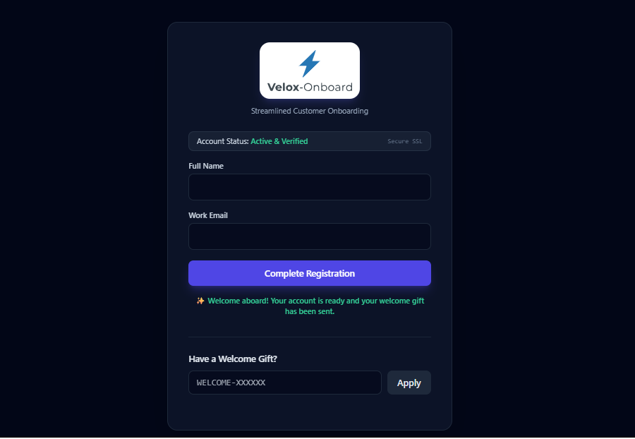

# Velox-Onboard

I built Velox-Onboard, an event-driven user lifecycle automation microservice. In SaaS platforms, drop-off rates during initial sign-up are critical. This system ensures that the moment a user registers, backend serverless functions instantly handle provisioning, incentive generation (like dynamic promo vouchers), and notification queuing asynchronously, ensuring a seamless Day-1 user experience.

<p align="center">
  
</p>

---

## Architecture & Lifecycle Overview

```
 [User Registration]
         │
         ▼ (Write to /users/{userId})
 ┌────────────────────────┐
 │   Cloud Firestore      │
 └──────────┬─────────────┘
            │ Document Created Event (users/{userId})
            ▼
 ┌─────────────────────────────────────────────────────────────┐
 │       Firebase Cloud Function: onboard_new_user             │
 └──────┬───────────────────────┬───────────────────────┬──────┘
        │                       │                       │
        ▼                       ▼                       ▼
 ┌──────────────┐        ┌──────────────┐        ┌──────────────┐
 │   Voucher    │        │   Settings   │        │     Mail     │
 │  Generation  │        │ Provisioning │        │    Queue     │
 │ (/vouchers)  │        │ (/settings)  │        │   (/mail)    │
 └──────────────┘        └──────────────┘        └──────────────┘
        │
        └───────────────────────► Mark User Profile Onboarded
                                  (users/{userId}.onboarded = true)
```

### Key Capabilities
- ⚡ **Event-Driven & Serverless:** Decoupled execution triggered automatically via Firestore document creation hooks.
- 🎟️ **Dynamic Incentive Engine:** Generates unique, time-bound promo codes (e.g., `WELCOME-XXXXXX`, 10% discount valid for 30 days) to drive immediate Day-1 conversion.
- ⚙️ **Instant Account Provisioning:** Automatically provisions user preferences and default settings (theme, notifications, language).
- 📬 **Asynchronous Mail Queuing:** Decouples notification delivery by writing to an outbound mail queue rather than blocking user registration.
- 🛡️ **Idempotency & Safety:** Built-in safeguards prevent duplicate provisioning or double-voucher issuance if document events replay.

---

## Tech Stack

- **Backend:** Cloud Functions for Firebase (Python 3.14, `firebase-admin`, `firebase-functions`)
- **Database:** Cloud Firestore (Document Database & Security Rules)
- **Frontend / Portal:** Vite, Vanilla TypeScript, Firebase Web SDK v13
- **Emulation & Testing:** Firebase Local Emulator Suite (Firestore, Functions, Emulator UI)

---

## Project Structure

```text
├── assets/
│   └── screenshot.png       # Portal UI preview
├── functions/
│   ├── main.py              # Serverless onboarding triggers & business logic
│   └── requirements.txt     # Python backend dependencies
├── web/
│   ├── src/
│   │   └── main.ts          # Frontend registration client wired to Firestore
│   ├── index.html
│   └── package.json
├── firebase.json            # Emulator & service configuration
├── firestore.rules          # Firestore security rules
└── README.md
```

---

## Getting Started Locally

### 1. Prerequisites
- **Node.js** (v18+)
- **Python** (v3.11+)
- **Java JRE** (required by the Firebase Emulator Suite)

### 2. Start the Firebase Emulator Suite
From the project root:

```bash
npx firebase emulators:start
```

The Emulator Suite will be accessible at:
- **Emulator Dashboard:** [http://localhost:4000](http://localhost:4000)
- **Firestore Emulator:** `localhost:8080`
- **Functions Emulator:** `localhost:5001`

### 3. Launch the Web Portal
In a new terminal window:

```bash
cd web
npm install
npm run dev
```

Open the displayed local URL (typically `http://localhost:5173`) in your browser to simulate user registration and observe real-time onboarding execution in your Firestore Emulator dashboard.

## 👨‍💻 Author
Built with precision by **Alexander Macharia**.
