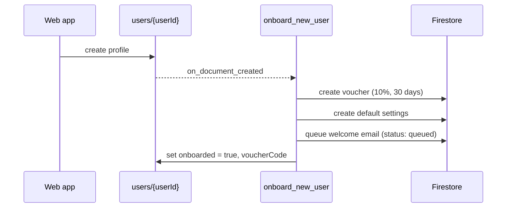

# Velox-Onboard: Architecture Overview

Event-driven user onboarding on Firebase. A new user profile triggers automatic provisioning, a welcome voucher and a queued email. A separate HTTPS endpoint redeems vouchers.

## Components

| Component | Type | Responsibility |
|---|---|---|
| `onboard_new_user` | Firestore trigger on `users/{userId}` | Provisions a new user |
| `redeem_voucher` | HTTPS endpoint (POST) | Validates and redeems a voucher |
| `generate_voucher_code` | Helper | Creates codes like `WELCOME-7K2PXQ` |
| `web/` | Vite + TypeScript + Tailwind | Frontend, Firebase Auth (Google, anonymous) |

## Data model (Firestore)

| Collection | Document ID | Key fields |
|---|---|---|
| `users` | userId | email, name, onboarded, voucherCode |
| `vouchers` | voucher code | userId, discountPercent, expiresAt, redeemed, redeemedAt |
| `settings` | userId | theme, language, emailNotifications |
| `mail` | auto ID | to, subject, body, status, createdAt |

## Onboarding flow

## Redemption flow

1. Client sends `POST` with `{ "code": "..." }`.
2. Function returns 400 (missing code), 404 (unknown code) or 400 (already redeemed).
3. Otherwise it sets `redeemed = true` and `redeemedAt`, and returns the discount.

## Known limitations (tracked as case studies)

| Issue | Risk | Planned fix |
|---|---|---|
| Redemption reads then writes in separate steps | Concurrent requests can double-redeem | Firestore transaction (ADR 0003) |
| `expiresAt` is not checked on redemption | Expired vouchers redeem | Validate inside the transaction |
| `onboarded` is set last | Trigger retries may duplicate voucher and email | Deterministic IDs and a transactional guard |
| No caller authentication, CORS `*` | Anyone with a code can redeem | Verify Firebase ID token, restrict origins |

These are documented deliberately. Each one is investigated in `docs/case-studies/`.
